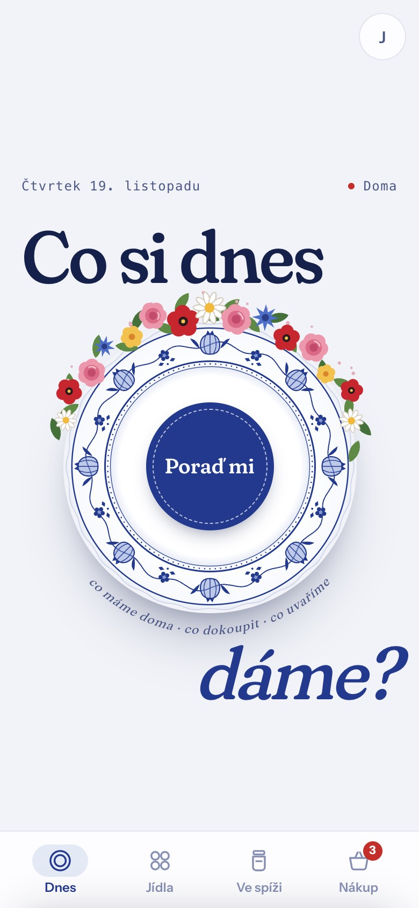
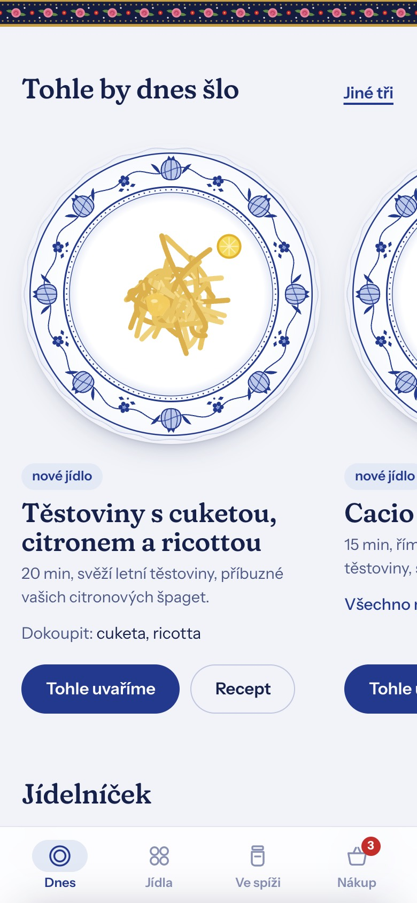
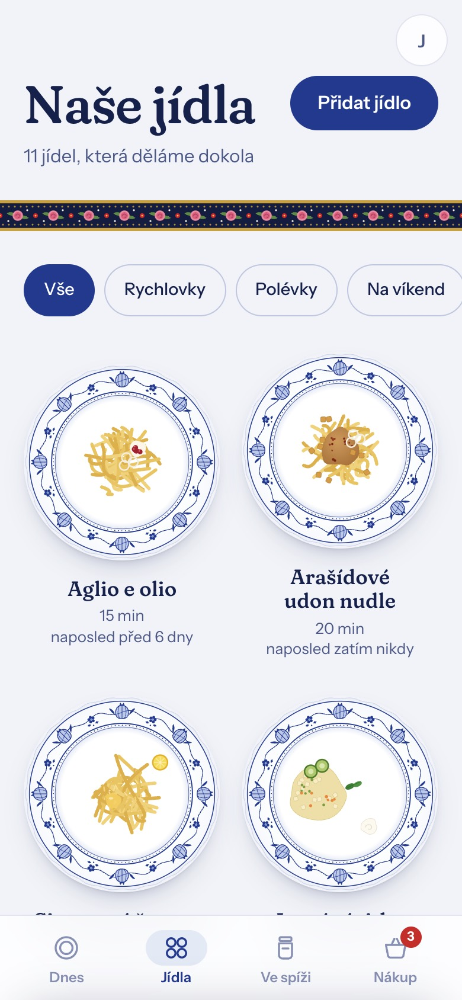
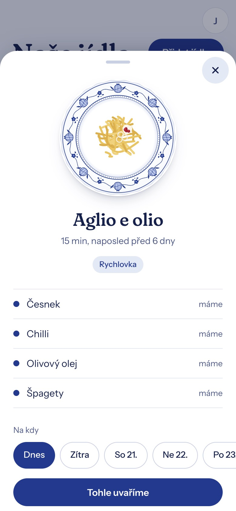
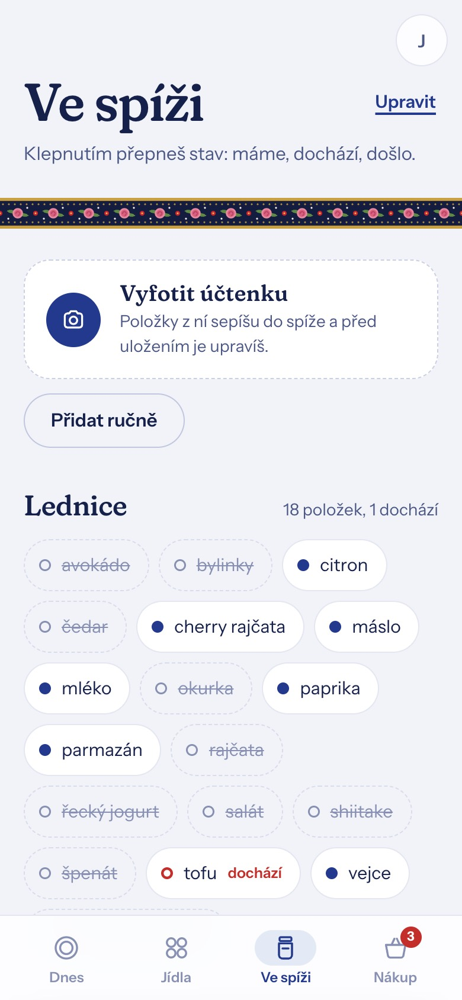

# Na talířku

Sdílená aplikace pro domácnost, která řeší, co si dnes uvařit a co k tomu dokoupit. Doporučuje jídla podle toho, co máte doma a jak dlouho jste je neměli, a nabízí i nová vegetariánská jídla. Je dělaná hlavně pro mobil jako aplikace na ploše, funguje ale i na počítači.

## Ukázka

<p>
  
  
  
  
  
</p>

Obrázky jsou z ukázkového režimu na mobilu.

## Co umí

- **Poraď mi.** Po klepnutí na talíř ukáže tři jídla, u každého čas a jestli máte všechno doma, nebo co dokoupit.
- **Filtry.** Návrhy jdou zúžit podle času, chuti a toho, jestli chcete osvědčená jídla, nová, nebo obojí.
- **Nová jídla.** Knihovna vegetariánských nápadů s postupem; srdíčkem nápad převezmete mezi svá jídla, palcem dolů ho skryjete.
- **Jídelníček.** Jídlo naplánujete na dnes nebo na některý z dalších šesti dnů a chybějící suroviny se přidají do nákupu.
- **Dlouho jsme neměli a Dochází.** Na hlavní obrazovce vidíte jídla, která jste tři týdny nevařili, a suroviny, které dochází.
- **Jídla.** Katalog vašich jídel s filtry podle štítků, detailem, historií vaření a podobnými novými jídly.
- **Spíž.** Suroviny v lednici, mrazáku a spíži přepínáte klepnutím mezi máme, dochází a došlo.
- **Účtenky.** Vyfocenou účtenku aplikace přečte přímo v telefonu a položky po kontrole zapíše do spíže.
- **Nákup.** Společný seznam, který oba vidíte hned po změně; odškrtnutá položka se vrátí do spíže jako máme.
- **Sdílení.** Jídlo nebo nákupní seznam jde poslat ve zprávě s odkazem, který otevře přímo aplikaci.
- **Domácnost.** Přihlášení e-mailem, druhý člen se připojí kódem domácnosti. Na další zařízení se jde přihlásit kódem bez e-mailu.

## Technologie

React 19, TypeScript a Vite, PWA přes `vite-plugin-pwa`, animace v GSAP. Data, přihlášení a sdílení v reálném čase běží na Supabase, účtenky čte Tesseract.js v prohlížeči.

```bash
npm install
npm run dev
npm run build
npm test
```

Bez `.env.local` běží aplikace v ukázkovém režimu: přihlášení se přeskočí a data se ukládají jen do prohlížeče. `npm run build` zkontroluje typy a sestaví aplikaci s PWA do `dist/`. `npm test` spustí testy doporučování a čtení účtenek.

Napojení na vlastní Supabase:

1. Propoj projekt a nahraj migrace: `supabase link --project-ref <ref-projektu>` a `supabase db push`.
2. Zkopíruj `.env.example` do `.env.local` a doplň `VITE_SUPABASE_URL` a `VITE_SUPABASE_ANON_KEY`.
3. V Authentication → URL Configuration nastav Site URL a Redirect URLs na adresu aplikace.
4. Nasaď funkci pro přihlášení kódem: `supabase functions deploy device-code`.

Volitelně jde zapnout čtení fotek přes Clauda (zvládne i fotku lednice). Stačí do Supabase secrets přidat `ANTHROPIC_API_KEY` a nasadit `supabase functions deploy parse-photos`. Bez klíče se účtenky čtou zdarma v prohlížeči.

Další skripty: `npm run icons` přegeneruje ikony PWA z `public/icon.svg`, `npm run seed:sql` vypíše SQL seed z `src/data/seed.ts`.

## Struktura

| Cesta | Obsah |
|---|---|
| `src/App.tsx` | kostra aplikace, navigace a otevírání detailů |
| `src/screens/` | obrazovky Dnes, Jídla, Spíž, Nákup, detaily a přihlášení |
| `src/components/` | sdílené prvky: spodní lišta, bottom sheet, čipy, toast |
| `src/plate/` | talíř s okrajem cibuláku a ilustrace jídel |
| `src/lib/recommend.ts` | výpočet doporučení a podobných jídel |
| `src/lib/store.tsx` | stav aplikace a zápisy do databáze |
| `src/lib/backend.ts`, `localBackend.ts` | napojení na Supabase a ukázkový režim |
| `src/lib/ocr.ts`, `receipt.ts` | čtení účtenek |
| `src/data/` | náš katalog jídel a knihovna nápadů |
| `src/styles/` | barvy, typografie a styly |
| `supabase/migrations/` | databázové schéma a pravidla přístupu |
| `supabase/functions/` | funkce pro přihlášení kódem a čtení fotek |
| `design/prototype.html` | klikací prototyp designu |
| `docs/` | obrázky do tohoto README |
